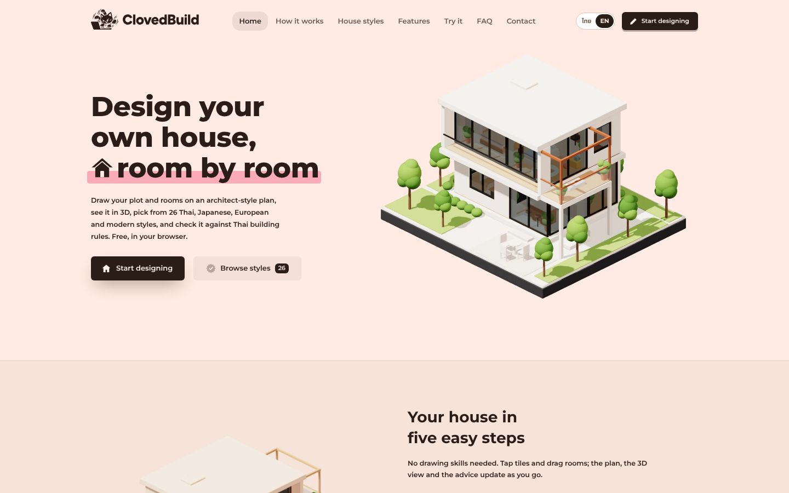
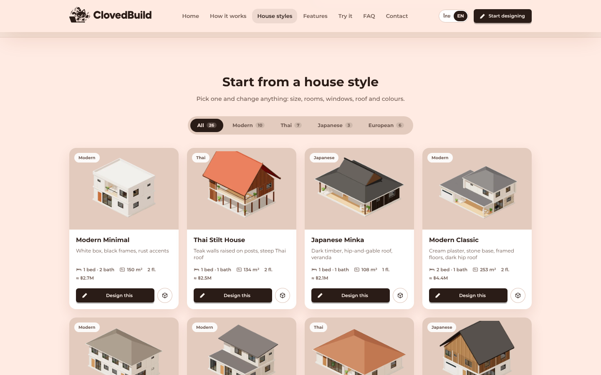
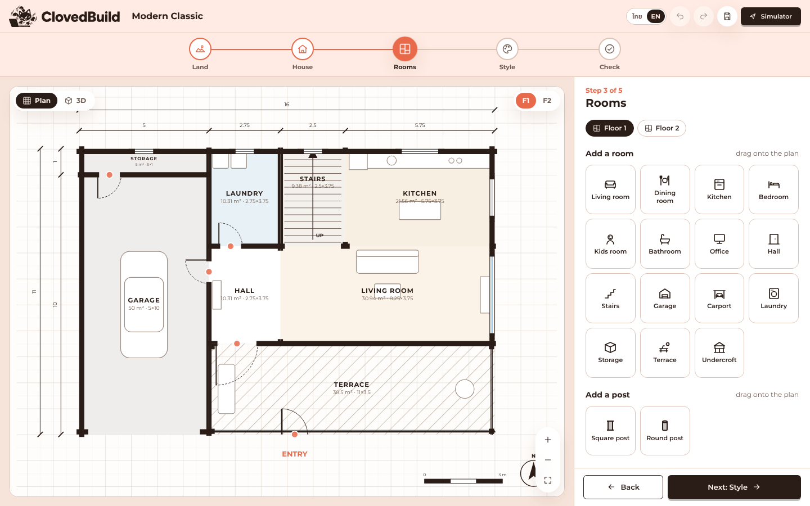
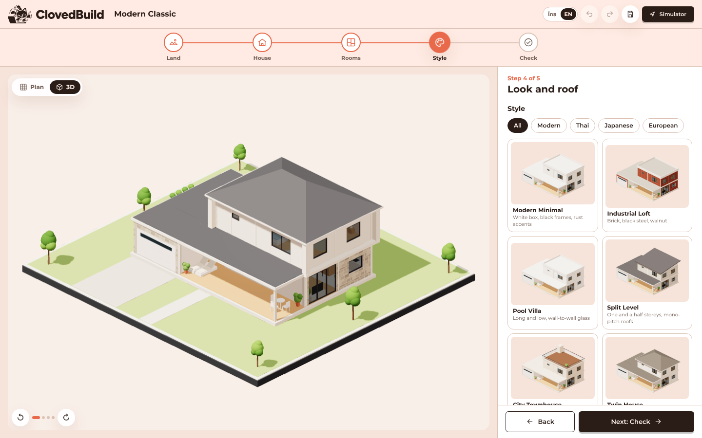
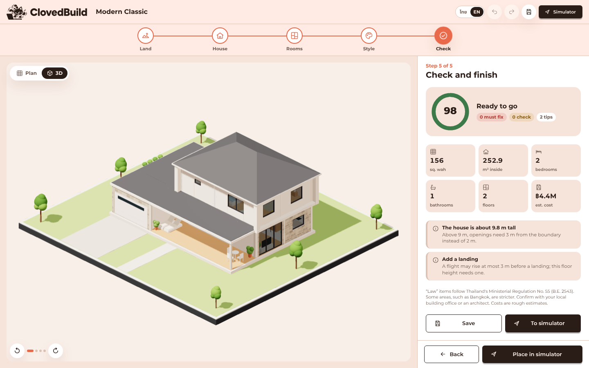
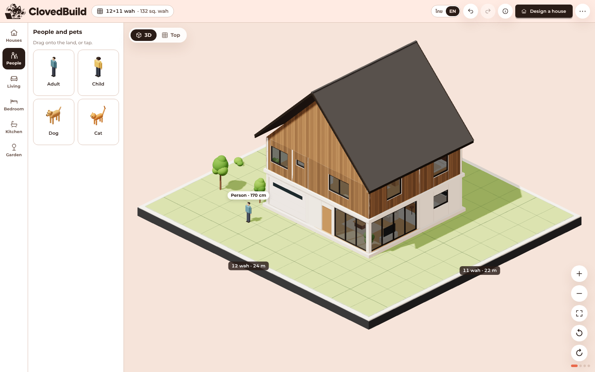
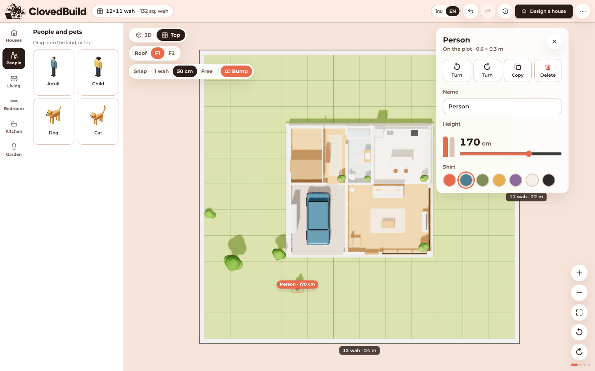

# ClovedBuild

A house-design website with a 3D, isometric home designer: pick a plot, shape the house, lay out the rooms room by room, style it, check it against building rules, then walk through it in a simulator. It is a design tool, not a real-estate listing site.

Built with **Astro 7, React 19, Tailwind CSS 4, three.js** and **Motion** (motion.dev) for spring animation. The interface is available in English and Thai.

## Screenshots

### Landing page


The home page opens with the headline and a 3D house, then walks through how it works. A sticky menu highlights the section you are reading and works in English and Thai.



The style gallery lists the 26 house styles (Modern, Thai, Japanese, European). Pick one to open it in the Builder or the Simulator.

### House Builder


The **Rooms** step shows an architect-style plan. Drag rooms in from the panel, move them, resize them, and place doors, windows, posts and furniture by hand. Every door has a handle; the dimension lines, entry mark, scale bar and north arrow update as you edit.



The **Style** step swaps the look of the whole house (roof, walls, colours, glass) and shows the result in 3D next to the style cards. Each floor can be viewed on its own.



The **Check** step scores the design against Thai building rules, lists what must be fixed, what to check and a few tips, and shows area, rooms and a rough cost. From here you can save the design or send it to the Simulator.

### House Simulator


The Simulator puts the house on a plot measured in wah. Drag houses, furniture, trees, cars, people and pets from the catalogue and drop them on the land. The grid is one square wah per cell.



Top view is for precise moving. It opens the roof or a single floor so you can place things inside the house, with snapping (1 wah, 50 cm or free) and collision ("Bump") so items do not overlap or pass through walls. A selected item gets its own panel: turn, copy, delete, name, height and colour.

## Getting started

Requires Node.js **22.23.4 or newer**.

```bash
npm install
npm run dev      # http://localhost:4321
npm run build    # static site in dist/
npm run preview  # serve dist/
```

## Pages

| Route | What it is |
|---|---|
| `/` | Landing page: how it works, style gallery, features, a live 3D studio, FAQ and contact |
| `/builder` | The house designer (5 steps: Land, House, Rooms, Style, Check) |
| `/simulator` | Place a house, furniture, trees, cars and people on a plot |

Open a ready-made house directly with `/builder?preset=<id>` or `/simulator?preset=<id>`.

## House Builder

A 5-step flow with a step bar on top and Back / Next buttons at the bottom. The workspace switches between **Plan** (architect-style drawing) and **3D** at every step. On phones the plan sits on top and the controls below.

- **Land**: plot size in *wah* (1 wah = 2 m), house position and setbacks, with a site plan showing the road and the 2 m window line.
- **House**: house size, 1 to 3 storeys, storey height, and 26 ready-made styles to start from. Layout templates scale to any footprint.
- **Rooms**: drag room icons onto the plan, resize and move them, and edit type, floor, wall colour and furniture per room. 13 room types (stairs, garage, carport, laundry, storage, terrace and more), L-shaped and angled rooms, kitchen and bathroom variants.
  - **Doors**: every door has a handle and can be dragged along any wall, including around corners. Single, double, sliding and open-archway types; width and swing direction are adjustable. Doors on shared walls connect two rooms; doors on outside walls are entrances.
  - **Windows**: move them, change their kind (window, glass wall, high window, door) and width.
  - **Posts**: drop square or round posts anywhere; they are modelled floor to ceiling and block furniture in the simulator.
  - **Furniture**: tap a piece, drag it anywhere inside the room, rotate it in 90° steps, or reset it.
- **Style**: roof (flat, roof terrace, gable, hip, mono-pitch, Thai, hip-and-gable, gambrel), wall finish (plaster, wood, siding, brick, half-timber, stone, marble, metal), colours, and amount of glass.
- **Check**: a rule check against Thai Ministerial Regulation No. 55 (B.E. 2543) plus comfort advice. Examples: open space of at least 30% of the largest floor, openings at least 2 m from the boundary (3 m above 9 m height), bedrooms of at least 8 m² and 2.5 m wide, ceiling height of at least 2.6 m, stair and corridor dimensions, and a door to the outside on an upper floor needs a balcony (a Terrace room) beyond it. The rules live in `src/lib/plan/rules.ts`.

Designs are saved in the browser (`localStorage`) under "My designs". **Place in simulator** sends the plot and house to the simulator.

Code: `src/lib/plan/` (`spec.ts` data, styles, templates and automatic doors and windows; `rules.ts`; `build3d.ts` builds the 3D house from a spec; `specStage.ts`; `storage.ts`) and `src/components/builder/`.

## House Simulator

- Plot size in wah, shown as sq. wah, rai-ngan-wah and m²; the grid is 1 square wah (2 × 2 m) per cell.
- 3D isometric view (rotate in 90° steps) and a top view for dragging.
- Drag items from the catalogue onto the plot, or tap to place them in the centre.
- Houses from the 26 styles or from the Builder, 1 to 3 storeys, viewed one floor at a time from above.
- Move any house, furniture, tree, car, pool, person or pet; snap to 1 wah, 50 cm or off. Items dropped inside the house land on the open floor.
- People have adjustable height, dogs a size, and colours can be changed. Collision stops items overlapping or passing through walls.
- Autosave, undo and redo, JSON export and import.
- Shortcuts: `R` rotate, `Delete` remove, `Ctrl/⌘+D` duplicate, `Ctrl/⌘+Z` undo, arrow keys nudge, `T` switch view.

Code: `src/lib/sim/` (`types.ts` catalogue, `models.ts` people, animals and cars, `world.ts` engine) and `src/components/sim/Simulator.tsx`.

## House styles

26 styles in four regions (Modern, Thai, Japanese, European), defined in `STYLES` in `src/lib/plan/spec.ts`, with ready-made houses in `HOUSE_PRESETS` and layouts in `TEMPLATES`.

The most recent additions are modelled on houses currently sold in the Pinklao-Salaya and Buddhamonthon area of Thailand:

- **Modern Classic** (`classic`): cream plaster, stone base, framed upper floor, dark hip roof, side garage and front porch.
- **Modern Japanese** (`gassho`): steep gassho-style gable, white walls, cedar upper floor, inspired by Shirakawa-go.

Beyond the basics, a style can set a roof pitch (`pitch`), street-facing cross gables (`crossGables`), louvred shutters (`shutters`), a different garage wall material (`garageLook`), per-floor finishes and frames (`floorLooks`), a wood gable (`gableFinish`), the ridge direction (`ridge`), slatted screens (`screens`), roof planters (`planters`) and round windows (`roundWindows`).

## Motion and performance

- Spring animation with Motion in `src/lib/springs.ts` (`ENTER`, `UI` and `SOFT` presets; `arrive`, `arriveAll`, `popOpen`). Elements reveal on scroll with a spring, un-blur as they arrive, and the mobile menu and gallery cards pop in.
- Page scrolling is native. Anchor links glide to the heading (`src/lib/smoothScroll.ts`); wheel smoothing is off by default and can be turned on with `initSmoothScroll({ wheel: true })`.
- `src/lib/hoverPolish.ts`: one-shot hover animations always play to the end, and sliding buttons reset at once if the pointer leaves half-way.
- Fonts (Montserrat, Noto Sans Thai) are self-hosted in `public/fonts/` and preloaded. Links are prefetched on hover (`astro.config.mjs`).
- Pointer moves on the plan are coalesced to one update per frame, other rooms' furniture is memoised while dragging, and the rule check runs deferred so it never blocks a drag.
- The landing page shows pre-rendered pictures from `public/renders/`, and the 3D studio only starts when it scrolls into view and pauses when it leaves.
- Everything respects `prefers-reduced-motion`.

### Re-rendering the pictures

The still images (hero, house and catalogue thumbnails) are generated by `scripts/render-thumbs.mjs`. It needs Playwright (with Chromium) and Python with Pillow:

```bash
npm run build && npx astro preview &
node scripts/render-thumbs.mjs                         # everything
node scripts/render-thumbs.mjs house-classic,house-gassho   # only some
```

## Project structure

```
src/
  pages/            index.astro, builder.astro, simulator.astro, dev/renders.astro
  layouts/          Layout.astro (head, fonts, scroll reveals)
  styles/           global.css (Tailwind, design tokens, dark mode, shared classes)
  config.ts         site settings, e.g. the contact e-mail
  components/       Header, Hero, About, WhyChooseUs, StyleGallery, HouseStudio,
                    Faq, ContactSection, Footer, LogoMark, icons, builder/, sim/
  lib/              plan/ (builder engine), sim/ (simulator), house/ (3D stage and
                    snapshots), i18n.ts, springs.ts, smoothScroll.ts, hoverPolish.ts
public/             fonts, renders, favicon, brand
scripts/            render-thumbs.mjs
```

## Customising

- **Colours**: CSS variables in `src/styles/global.css` (there is a separate dark palette).
- **Contact form**: set `CONTACT_EMAIL` in `src/config.ts`. While it is empty, the form copies the message for the visitor instead.
- **Add or change a style**: edit `STYLES`, `HOUSE_PRESETS` and, if needed, `TEMPLATES` in `src/lib/plan/spec.ts`, add the Thai text in `src/lib/i18n.ts`, then re-render the thumbnail.
- **Add a simulator item**: add it to `CATALOG` in `src/lib/sim/types.ts`; for a new model, add a builder in `models.ts` and a case in `buildModel()` in `world.ts`.
- **Translations**: text in `.astro` files uses `<T en="…" th="…" />`; strings in code go through `src/lib/i18n.ts`.

## Notes

- Saved designs live in the browser's `localStorage` only.
- Unused legacy components that can be deleted: `SearchBar.tsx`, `Residences.tsx`, `Testimonials.tsx`, `HouseShot.tsx`.
- The logo is a black cat typing on a laptop (`src/components/LogoMark.tsx`, original artwork in `public/brand/`). It is traced to vector and follows the theme colour.
